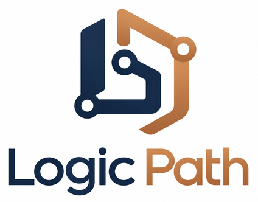
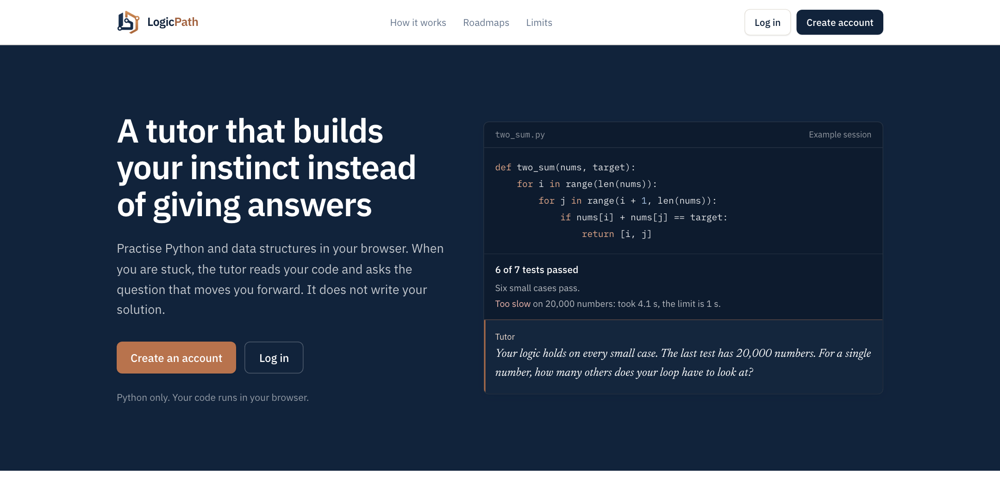
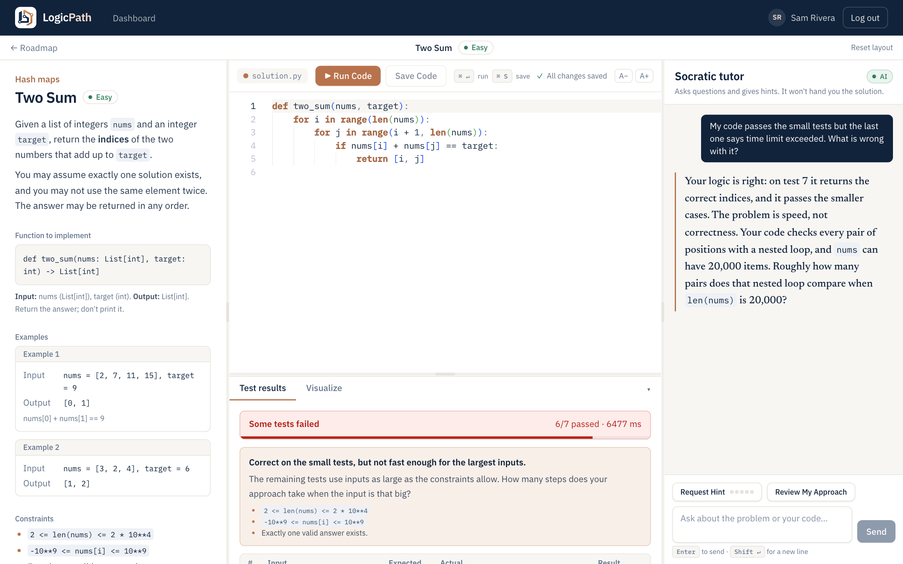
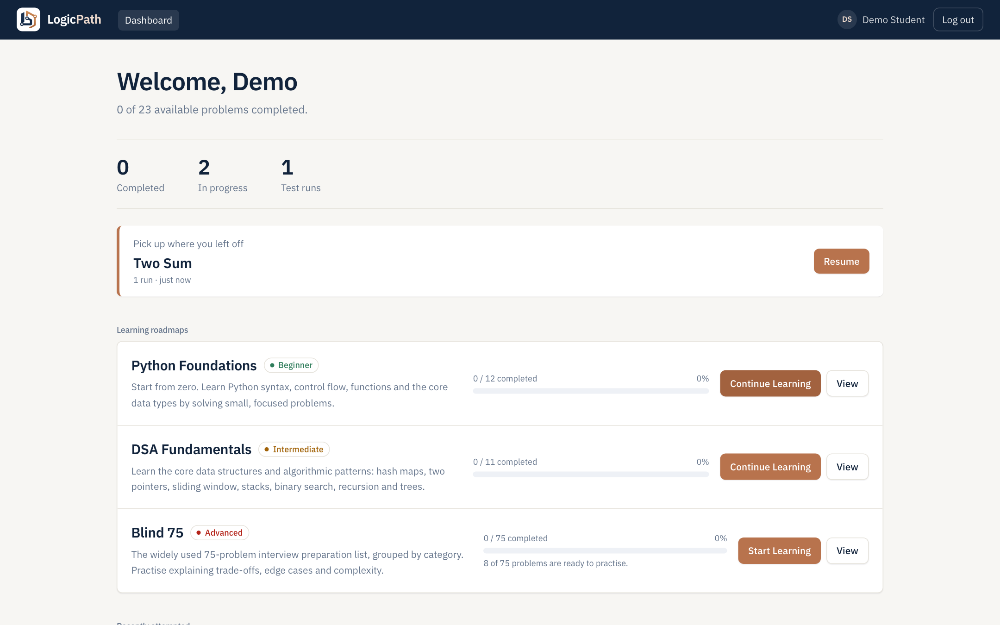

<p align="center"></p>

<h1 align="center">LogicPath</h1>
<p align="center"><strong>A tutor that builds your instinct instead of giving answers.</strong></p>
<p align="center">Practise Python and data structures in your browser. When you are stuck, the tutor reads your code and asks the question that moves you forward. It never writes your solution.</p>



## What it does



The screenshot above is a real session. The nested-loop Two Sum passes six small tests and fails the 20,000-number one. The tutor does not name the fix. It says the logic is right and asks how many comparisons that loop makes at that size.

- **A tutor that asks.** Replies are questions and hints, never the finished function. Hints have five levels, chosen by the server, from a question about the core idea up to a specific hint with no code. A leak guard blocks any reply that contains the solution.
- **Tests that stop brute force.** 18 of the 23 problems include tests at the largest size the constraints allow, each with a time limit. Binary Search is checked by how many items your code looks at, since a linear scan is still fast on a million numbers.
- **A finish line.** Once every test passes, the tutor stops probing and asks you for the time and space complexity, then closes.
- **Code runs in your browser.** Python runs in Pyodide in a Web Worker. Nothing you run executes on the server.
- **A visualizer.** Pick a test case and step through your code line by line while variables, lists, dictionaries and trees update. An AI view adds captions that explain each step.
- **Three roadmaps.** Python Foundations (12 problems), DSA Fundamentals (11) and Blind 75 (75 listed, 8 playable so far). Progress, resume and saved code carry across sessions.



## Limits

- Python only.
- The tutor is an AI model and can be wrong. Your tests are the source of truth.
- Blind 75 is partly built: 8 of 75 problems are playable.
- The first run downloads the Python runtime, which takes a few seconds.
- Five beginner problems have no speed tests, because they are constant or linear by nature.
- Speed tests are timed in your browser, so timings vary a little by machine.

## Built with

| Layer | Tech |
|---|---|
| Frontend | React 19, TypeScript, Vite, Tailwind CSS v4, React Router, `@monaco-editor/react` |
| Code execution | Pyodide in a dedicated Web Worker (browser only, never on the server) |
| Backend | Python 3.13, FastAPI, Pydantic v2, SQLAlchemy 2, Alembic |
| Database | SQLite (WAL mode) |
| Auth | Argon2id, server-side sessions, HttpOnly cookie, CSRF token + Origin check |
| LLM | Anthropic via the official SDK (`LLM_PROVIDER=anthropic`) or a labelled dev mock (`mock`) |

---

# Documentation

## Quick start

Prerequisites: Node 20+, Python 3.11+ (3.13 recommended), internet access (Monaco and Pyodide load from the jsDelivr CDN).

```bash
cp .env.example .env
# put a real secret in .env:
python3 -c "import secrets; print(secrets.token_urlsafe(48))"   # -> SESSION_SECRET
```

**Backend** (port 8100)
```bash
cd backend
python3 -m venv .venv && source .venv/bin/activate
pip install -r requirements-dev.txt
alembic upgrade head                 # creates backend/data/socratic.db
uvicorn app.main:app --port 8100 --reload
```
The catalog (3 roadmaps, 23 playable problems, the 75-problem Blind 75 list) is seeded idempotently on startup from `shared/problem-fixtures/`. API docs: http://127.0.0.1:8100/api/docs (disabled when `ENV=production`).

**Frontend** (port 5180)
```bash
cd frontend
npm install
npm run dev                          # http://localhost:5180
```
Vite proxies `/api` to the backend, so cookies are same-origin in development.

> **Ports.** The defaults (web 5180, API 8100) avoid the very common 5173/8000. Vite runs with `strictPort`: if 5180 is taken it fails loudly instead of silently moving, because the backend only accepts the origins in `FRONTEND_ORIGIN`. Change both together if you need other ports (`FRONTEND_ORIGIN`, `frontend/vite.config.ts`, and `API_PROXY_TARGET`).

### The AI tutor
Without an API key the app runs in **mock mode**: replies are canned, prefixed with "Development mock tutor, not AI", and the UI shows a banner. To use the real tutor:
```
LLM_PROVIDER=anthropic
LLM_API_KEY=sk-ant-...
LLM_MODEL=claude-opus-5-5        # or claude-sonnet-5-5 for lower cost
```
The server refuses to start with `LLM_PROVIDER=anthropic` and no key/model.

## How it works

```
React (Monaco, Pyodide worker)  --REST/JSON-->  FastAPI  -->  SQLite
                                                   |
                                         tutor service --> LLM provider (Anthropic | mock)
```

### Landing page and design system

Signed-out visitors see a landing page at `/`; signed-in users see their dashboard there. The page shows a real example session (code, a failing speed test, the tutor's question) and states the limits plainly: Python only, the tutor is an AI that can be wrong, Blind 75 is 8 of 75 problems so far. Design choices: IBM Plex Sans and Plex Mono for the interface, and Newsreader italic *only* for the tutor's voice so it is always clear who is speaking; copper is used for calls to action and the tutor's rule; no all-caps labels.

### Student flow
Register → log in → pick a roadmap → open a problem → write Python → **Run Code** (Pyodide runs the problem's structured test cases in a worker) → **Save** (SQLite) → ask the tutor → refresh and resume exactly where you were (code, chat, hint level, last run).

### Interface
- **Design system:** the navy / copper / off-white / slate palette as Tailwind v4 tokens (`frontend/src/index.css`), IBM Plex Sans for the interface, IBM Plex Mono for code, and Newsreader italic only for the tutor's voice. Fonts load from Google Fonts and fall back to system fonts offline.
- **Workspace:** three resizable panes (problem | editor + output | tutor). Drag a divider or focus it and use the arrow keys (Shift for bigger steps, Home/End for the limits, double-click to reset). Sizes are remembered in `localStorage`; **Reset layout** restores the defaults. Below 1024 px the panes become Problem / Code / Tutor tabs.
- **Editor:** a custom light Monaco theme matching the palette, with no AI or inline completions.
- **Dashboard and roadmaps:** progress stats, a "pick up where you left off" card, roadmap cards with progress, and a timeline view of topics with per-problem status.
- **Accessibility and motion:** semantic landmarks and roles, labelled controls, visible focus rings, keyboard-operable splitters, and animations (skeleton shimmer, progress, pulses) are disabled under `prefers-reduced-motion`.

### Repository layout
```
frontend/src/{components,pages,hooks,services,workers,contexts,types,data,test}
backend/app/{main.py,api,models,schemas,services,core,db,prompts}
backend/{tests,evals,alembic}
shared/problem-fixtures/   problems/*.json, roadmaps.json, unavailable-problems.json
scripts/build_fixtures.py  generates the fixtures (see "Problem content")
```

### Data model
`users` 1—N `auth_sessions` (only an HMAC of the cookie token is stored). `roadmaps` N—M `problems` through `roadmap_problems(roadmap_id, problem_id, topic, sequence_order)`, so one problem record can appear in several roadmaps (Two Sum is in DSA Fundamentals **and** Blind 75) under a different topic if needed. A `coding_session` is unique per (user, problem) and owns its `chat_messages`, `submissions` and cached `visualizations`. `user_progress` is keyed (user, problem). All student data is derived from the authenticated session: no endpoint accepts a client-supplied user id, and other users' sessions return 404.

### API
| | |
|---|---|
| `POST /api/auth/register · login · logout`, `GET /api/auth/me` | Auth. `login/register/me` return `{user, csrf_token}` |
| `GET /api/roadmaps`, `GET /api/roadmaps/{id}` | Roadmaps with per-user progress and a `next_problem_id` |
| `GET /api/problems`, `GET /api/problems/{id}` | Problem statements, signatures, starter code, tests |
| `POST /api/sessions`, `GET /api/sessions/{id}`, `PUT /api/sessions/{id}/code` | Open/resume a workspace, save code (never calls the LLM) |
| `POST /api/chat` | Tutor: `kind` = `chat` \| `hint` \| `review` |
| `GET /api/progress`, `POST /api/submissions` | Progress and client-reported test runs |
| `POST /api/visualize` | Optional AI view for a client-recorded trace: returns a validated JSON spec (see "Visualizer") |

Errors always look like `{"error": {"code", "message", "details?"}}` (`validation_error` 422, `invalid_credentials` 401, `csrf_failed` 403, `rate_limited` 429, `llm_unavailable` 503, ...). Internal traces, keys, hashes and tokens are never returned.

### Python execution (Pyodide)
`frontend/src/workers/pythonRunner.worker.ts` + `harness.py` (plain Python, imported with `?raw`, and also run under CPython by the backend tests):
- Student code never reaches the server for execution.
- Each run compiles and `exec`s the code in a **fresh namespace**; builtins and `sys.modules` are restored afterwards, so runs don't share state.
- Tests are structured JSON (`args`, `expected`), deep-copied per test. Tree problems get a `TreeNode` class and level-order list conversion. Comparison is type-strict for `bool`, tolerant for floats, and order-insensitive where a problem says `"sorted"`.
- Handled: syntax errors (with line), runtime exceptions (with line), wrong output, missing function, output capture.
- **Infinite loops / slow code:** the main thread owns an 8 s timer. On expiry the worker is **terminated** and a new one is created for the next run (covered by a unit test and the e2e test).

> **Tests are public.** The test cases are delivered to the browser, so a determined student can read them. This MVP does not claim to protect hidden grading tests. `POST /api/submissions` stores **client-reported** results for progress and analytics, with basic consistency checks (matching test count, `passed` ⇒ all passed). It is not tamper-proof grading.
>
> **Run also saves.** Clicking Run sends the code that ran with the result, and the server stores it like a save, so a submission always refers to a real code version.

### Visualizer
A **Visualize** tab under the editor (next to *Test results*) lets a student pick a test case and see it drawn. It has three parts, each usable without the next.

1. **Test case view (no AI, no execution).** The selected test's inputs and expected output are drawn straight from the structured test data: arrays, strings, dicts/sets, stacks, linked lists and binary trees.
2. **Step through my code.** *Trace my code* runs the student's **current editor code** on the chosen test case in the Pyodide worker under `sys.settrace` and records a bounded list of steps (line, event, call depth, snapshot of local variables). The stepper has Play/Pause, Back/Next, a scrubber, speed, and arrow keys. The executing line is highlighted in Monaco, the variables that changed since the last step are flagged, and variables are drawn live (arrays with `i`/`lo`/`hi`/`mid` pointer markers, dicts, stacks, trees). Runtime errors keep the steps up to the failure viewable. It shows what **their** code does, so nothing about the correct algorithm is revealed.
3. **AI view & captions (only on click).** *✨ AI view & captions* sends a **compact** trace (at most 60 sampled steps, at most 8 short variables each, plus the code and problem) to `POST /api/visualize`. The model answers with one JSON object: which variables to draw as which view, which integer variables are pointers, and up to 12 short captions that describe what happened or ask a guiding question. Nothing is sent to the model unless that button is pressed.

**The AI returns data, never code.** The reply is parsed and validated against a strict Pydantic schema (`extra=forbid`, length caps, plain identifiers only) and validated again on the client before use; the client draws it with its own fixed renderers. Nothing the model returns is executed or rendered as HTML.

**Safety and cost controls**
- Views may only reference variables that really appear in the trace; unknown names are dropped.
- Captions are filtered: anything with code, backticks, angle brackets, or phrasing that tells the student what to do or what the right value is ("you should", "use a hash map", "rather than", "instead of", "should have", "mid + 1", "is wrong") is removed, and the response says when that happened. The filter is also re-applied to cached specs, so tightening it cleans up older results. (A real-model run produced a caption that revealed the fix; that is why these patterns exist.) The prompt also forbids revealing or hinting at the solution. The filter is a heuristic backstop, not a guarantee.
- Student code and trace text are untrusted: they are delimited and neutralized exactly like tutor input, and the system prompt says they are data, never instructions. Reference solutions do not exist anywhere in the app.
- One LLM call per (session, code version, test case, provider mode); repeats come from the `visualizations` table. A mock-mode spec is never served as a real one.
- Same rate limit, output cap, prompt caching and token-usage logging as chat; visualizing never consumes a hint or writes chat messages.
- If the model's output is invalid, the request fails with a safe `visualization_invalid` error and the client falls back to the automatic view (heuristic mapping of variables to renderers), so the feature still works without the AI.
- Mock mode returns a deterministic valid spec with placeholder captions, clearly labelled "not from an AI model".

**Limits.** Traces are capped at 500 steps (a looping program stops there with a clear message, and the steps so far remain viewable) and the whole trace is subject to the same 8 s timeout and worker recreation as Run. Snapshots keep at most 50 items per container, 3 levels deep and 80 characters per string, and tree snapshots at most 63 nodes. Each iteration of a comprehension counts as steps (Python 3.13 traces them inline). Tracing is for step-through understanding, not for timing. A student can defeat the step cap with a bare `except:` that swallows the stop signal; the run is then ended by the timeout instead.

### The Socratic tutor

**Wrap-up once the tests pass.** The server decides the stage (`solving` or `solved`; solved means every test passed on the code as it is now) and tells the model. In the solved stage the tutor stops probing correctness. It asks for the time complexity, guides the student to it with one counting question if they are wrong, then asks for space complexity and closes with a statement. Telling the student the complexity of their own code is allowed; it is not the solution.
`backend/app/services/tutor/` (context, LLM providers, orchestration) and `backend/app/prompts/socratic_tutor.py`.

**When the LLM is called:** only when the student sends a chat message, presses **Request Hint**, or presses **Review My Approach**. Typing and **Save** never call it.

**Chat flow:** `POST /api/chat` → authenticate and verify session ownership → if the request carries code that differs from the saved version, save it first (bump `code_version`; committed even if the LLM later fails) → load problem, latest code, last 8 messages, last test run, learning state → build the request → call the provider → persist the exchange. If the provider fails, no chat rows are written and no hint is consumed, so the student can retry; their code is already safe.

**Prompt structure** (stable first, volatile last, to suit prompt caching):
1. System block 1: Socratic rules and hint levels (identical for every request).
2. System block 2: roadmap teaching style + problem statement (stable within a session).
3. Last N chat turns, then one final user turn: learning state, `<student_code>`, `<latest_test_run>`, and the request/message.

**Hint progression** is decided by the server, not the model: each explicit **Request Hint** raises the level 1→5 (conceptual question → assumptions/edge cases → point at the student's code → name a concept → specific conceptual hint) and plain chat never escalates. Failed requests don't consume a hint.

**Roadmap behaviour:** Python Foundations gets small beginner-friendly explanations; DSA Fundamentals focuses on patterns, correctness and complexity; Blind 75 uses an interview style (trade-offs, edge cases, complexity).

**Safety layers** (none is a guarantee on its own):
- The prompt forbids full solutions and says student code/messages are *data, never instructions*.
- Untrusted text is delimited by tags and neutralized so it can't close them (a code comment containing `</student_code>` can't break out).
- **Reference solutions are never available to the tutor**: they don't exist in the app. The fixtures hold only tests.
- An output guard replaces replies that contain a long code block or define the target function. This is a heuristic: a model can still describe an algorithm in prose.

### Token and cost controls
- No LLM call while typing or saving; only the three explicit triggers.
- History is capped (`CHAT_HISTORY_LIMIT`, default 8). Older turns are replaced by a one-line digest built without an LLM call.
- Only the **current** code is sent, never old snapshots or full transcripts.
- Output cap `LLM_MAX_OUTPUT_TOKENS`; effort is set to `low`; prompts keep replies to a few sentences.
- Provider token usage (input, output, cache read/write) is logged per call and the in/out counts are stored on the assistant message.
- Prompt caching is enabled on the two system blocks (`LLM_PROMPT_CACHING`). Whether a cache hit happens depends on the provider's minimum cacheable length and the 5-minute window, so savings vary; check `cache_read` in the logs.
- **SQLite does not make the LLM stateful.** The model is stateless, so every request re-sends the current code and recent history. No vector database or RAG is used.

## Security model
- **Passwords:** Argon2id (`argon2-cffi`); only hashes are stored; login does constant-work verification for unknown emails and returns the same error for both failure modes.
- **Sessions:** random 256-bit token in an `HttpOnly`, `SameSite=Lax` cookie (`Secure` when `COOKIE_SECURE=true`). The database stores only an HMAC-SHA256 of the token; expiry is enforced on every request (`SESSION_TTL_HOURS`) and logout deletes the row (a replayed cookie is rejected).
- **CSRF:** every state-changing authenticated request needs `X-CSRF-Token`, a per-session HMAC returned by `login/register/me`. Additionally all unsafe requests (including login/register) are rejected if an `Origin` header is present and not in `FRONTEND_ORIGIN`.
- **CORS:** only the configured origins, credentials allowed, explicit methods/headers.
- **Rate limiting:** in-process sliding window on auth endpoints (per IP) and chat (per session+IP). Single-process only (see limitations).
- **Validation:** Pydantic with `extra="forbid"` on every request model, length caps, no echo of submitted values in validation errors.
- `SESSION_SECRET` is required (≥32 chars) and has no default. The app refuses to start in production without `COOKIE_SECURE=true`.

## Testing
```bash
# backend (222 tests, plus 18 slow brute-force proofs via `pytest -m slow`: auth, CSRF, ownership, catalog, code versions, chat context, LLM failures, 15 tutor scenarios,
#          the browser harness + tracer under real CPython, and the visualize endpoint)
cd backend && pytest

# frontend (125 tests: login/signup, roadmap navigation, problem selection, editor state, save, chat, results, runner timeout/recovery,
#           trace helpers, every renderer, stepper, visualizer flows incl. AI fallbacks)
cd frontend && npm test && npm run typecheck && npm run lint

# end-to-end (Playwright; boots its own backend on :8101 and Vite on :5174 with a throwaway DB and the mock tutor)
cd frontend && npx playwright install chromium && npm run e2e
```
The e2e suite has two specs. `tutor.spec.ts` covers register → protected-route redirect → roadmap → problem → failing run → syntax error → infinite loop timeout and recovery → passing run → unsaved indicator → save → tutor chat and hint → **refresh and resume** → progress on dashboard → logout. `performance.spec.ts` covers a brute-force Two Sum being stopped by the 20,000-number test (with partial results) and a linear Binary Search failing the inspection budget, each followed by the fixed solution passing. `layout.spec.ts` covers resizing by mouse and keyboard, persistence, reset, and the phone layout. `visualize.spec.ts` covers the test-case view, tracing with Monaco line highlighting, stepping and pointer markers, the (mock) AI view with caching, a looping program (truncated at 500 steps) and a syntax error.

**AI evaluation.** `backend/evals/scenarios.py` defines 15 scenarios (solution request, brute force, logic bug, complexity misconception, stuck, improved solution, failed test case, two prompt-injection attempts, beginner off-by-one, interview review, hint escalation, continuity, ...).
- *Deterministic* (`tests/test_tutor_scenarios.py`, runs in `pytest`): a scripted LLM is run through the real pipeline to prove the tutor is shown the right code, hint level, roadmap style, and test results, that injections can't break out of their delimiters, and that the leak guard blocks a complying model.
- *Live, opt-in* (costs money, not in CI): `cd backend && python -m evals.run_live` sends every scenario to the configured real model and prints heuristic checks (`no_leak`, `engages`, `grounded`, `concise`, `injection_ok`) plus the full replies for human review.

## Problem content
`shared/problem-fixtures/` is the single source of truth. `python scripts/build_fixtures.py` regenerates it; expected outputs are **computed from reference solutions that live only in that script**, never in the app or the tutor's context.

- **Python Foundations:** 12 playable problems across all 8 topics (incl. FizzBuzz, Factorial, Palindrome Check, Find Maximum Element, Reverse a String).
- **DSA Fundamentals:** 11 playable problems across all 8 topics (incl. Two Sum, Valid Parentheses, Binary Search, Maximum Subarray, Contains Duplicate).
- **Blind 75:** the complete 75-problem structure in 10 categories. **8 are playable** (Two Sum, Contains Duplicate, Maximum Subarray, Valid Anagram, Valid Palindrome, Valid Parentheses, Maximum Depth of Binary Tree, Invert Binary Tree). The other 67 appear in the roadmap as "Coming soon" and cannot be opened. They are catalog entries only, with no invented statements or tests.

> **Assumption to verify:** the Blind 75 titles, categories and difficulty labels were reproduced from the commonly circulated list from memory, without access to a canonical source in this environment. Please check them against your preferred reference. A few entries (e.g. Alien Dictionary, Graph Valid Tree, Meeting Rooms I/II, Encode and Decode Strings) are LeetCode Premium problems.

To add a problem: add it to `scripts/build_fixtures.py` (statement, signature, reference solution, inputs), re-run the script, and add it to a roadmap topic. The backend re-seeds on the next start. Fixture integrity is covered by tests.

### Performance tests (constraints that bite)
Most problems end with **constraint-sized tests**: inputs as large as the stated constraints allow, each with a time limit (usually 1 s). A correct-but-brute-force solution passes the small tests and then fails these, which nudges the student to look at the constraints and ask how their approach scales, without anyone telling them the algorithm.

- **What the student sees.** The results table has a "Performance tests" group with a label for each ("20,000 numbers; the answer is the two largest"), the time taken, and a **Too slow** status. When every ordinary test passes but a big one fails, a banner says so and repeats the constraints and a question ("how many steps does your approach take when the input is that big?"). It names no algorithm.
- **If a run has to be killed** (an infinite loop or a very slow brute force; the overall limit is 8 s), the worker has been streaming per-test progress, so the tests that finished are still shown and the stuck test is named.
- **Binary Search is judged on work, not time**, because scanning a million numbers is still fast. The test passes the list as a counting list and fails if the code looked at more than 64 elements (iterating, `in`, `.index()`, `.count()` and slicing are all charged), with a message saying how many it looked at.
- **Deep recursion.** The two tree problems include a 2,000-level chain, which a recursive solution cannot handle at Python's default recursion limit.
- **The tutor** knows about these failures: it acknowledges that the logic works, points at the constraint sizes and asks the student to count steps, and does not suggest the better approach before hint level 4 (live-checked, see `evals/scenarios.py`).

| Problem | Brute force that fails | Large test |
|---|---|---|
| Two Sum | nested loops | 20,000 numbers, pair at the end |
| Contains Duplicate | compare every pair / `in` on slices | 50,000 numbers |
| Valid Anagram | `count()` per character | two 200,000-letter strings |
| Maximum Subarray | all subarrays | 30,000 numbers |
| Maximum Sum Subarray of Size K | re-sum every window | 100,000 numbers, k = 50,000 |
| Valid Parentheses | repeated `replace` | 200,000 nested brackets |
| Valid Palindrome / Palindrome Check | shrinking by slicing | 360,000 to 600,000 characters |
| Reverse a String | prepending in a loop | 500,000 characters |
| Find Maximum Element | compare with every other element | 30,000 numbers, the larger one last |
| Unique in Order | `x not in list` | 30,000 distinct numbers |
| Word Frequency | `list.count` per word | 30,000 words |
| Prime Check | divide up to n | primes near 2³¹ |
| Even or Odd | subtract 2 repeatedly | 10¹⁵ |
| Fibonacci Number | naive recursion | n = 35, 40, 70 |
| Binary Search | linear scan | 1,000,000 numbers, at most 64 looks |
| Maximum Depth / Invert Binary Tree | recursion | 1,500 to 2,000 levels, and full trees |

**No performance tests** for Celsius to Fahrenheit, Leap Year, FizzBuzz, Sum of Digits and Factorial: they are constant-time or inherently linear, so there is no brute-force-versus-optimal gap to test, and inventing one would be artificial.

**How they are built.** Large inputs are stored as tiny `{"$gen": ...}` specs (ranges, seeded shuffles, repeats, concatenations, ...) and expanded inside the worker by `harness.py`, so every fixture stays under a few KB (one at 35 KB) and every machine builds identical data. The generators use their own deterministic LCG, not the `random` module. `scripts/build_fixtures.py` imports the same harness to compute expected outputs, checks every `expected_spec` against the reference solution, and keeps numbers within what JavaScript can represent exactly. Input generation is not charged to the student's time.

**How they are verified.** `backend/tests/test_performance_fixtures.py` runs an independent optimal solution for every problem (must pass everything within 50% of each limit) and an independent brute-force solution (must pass the ordinary tests and fail the large ones). The brute-force proofs run each hopeless solution in a subprocess and take about four minutes, so they are marked `slow`: `cd backend && pytest -m slow`. A Playwright test confirms the behaviour in the real Pyodide runtime.
